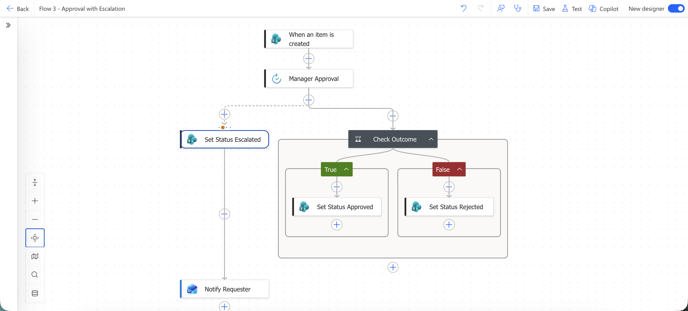
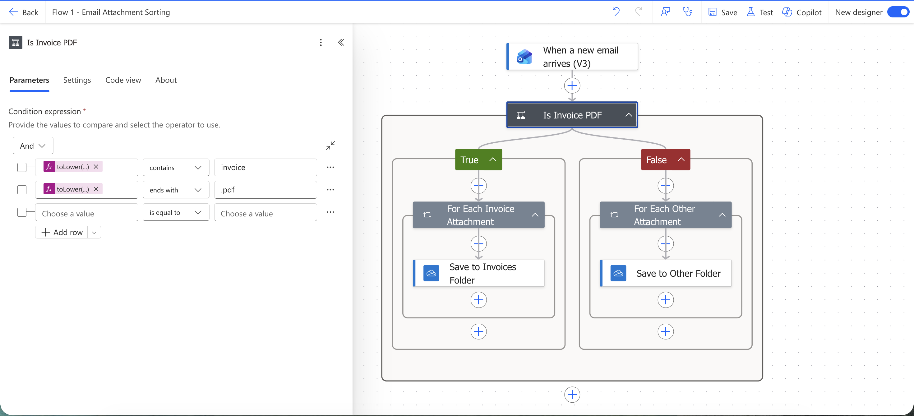
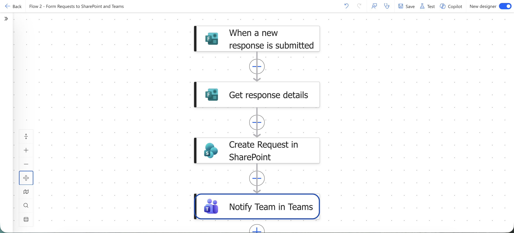
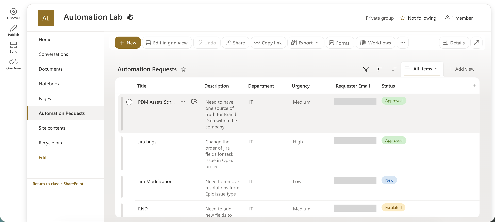

# Office Process Automation (Power Automate)

Three Microsoft Power Automate cloud flows for common internal processes: sorting incoming files, taking requests from a form, and approvals that must not get stuck. I built and tested them alone in a Microsoft 365 test tenant (Business Standard trial, two test users), October 2026.

**Flows:** email attachments → OneDrive folders · Microsoft Forms → SharePoint list → Teams · new list item → approval → status, or escalation after 2 days

## What it does

### Flow 1: Attachment sorting (Outlook, OneDrive)

1. **Trigger** (`When a new email arrives (V3)`): a new email with attachments arrives.
2. **`Is Invoice PDF`:** the subject contains "invoice" and the attachment name ends with ".pdf" (both case-insensitive, via `toLower`).
3. **`For Each Invoice Attachment`** → **`Save to Invoices Folder`** in OneDrive.
4. **File names** get a timestamp, so files with the same name never overwrite each other.
5. **`False` branch:** **`For Each Other Attachment`** → **`Save to Other Folder`**, so nothing is lost.

### Flow 2: Requests from a form (Microsoft Forms, SharePoint, Teams)

1. **Form** "Automation Request" in Microsoft Forms.
2. **`When a new response is submitted`** → **`Get response details`**.
3. **`Create Request in SharePoint`**: one row per request in the list "Automation Requests" (site "Automation Lab").
4. **`Notify Team in Teams`**: a message tells the team a new request has arrived.

The list keeps title, description, department, urgency, requester email and status (`New`, `Approved`, `Rejected`, `Escalated`; the status is set by Flow 3).

### Flow 3: Approval with escalation (SharePoint, Approvals, Outlook)

Flow 3 picks up the requests that Flow 2 writes to the list, so together they form one process: form → list → approval → status.

1. **Trigger** (`When an item is created`): a new item appears in the "Automation Requests" list.
2. **`Manager Approval`** (`Start and wait for an approval`) is sent to the approver.
3. **Timeout:** 2 days (`P2D`) in the action settings.
4. **Escalation branch** (`Configure run after` → has timed out): **`Set Status Escalated`**, then **`Notify Requester`** sends an email: "Your request was not reviewed in time and has been escalated."
5. **`Check Outcome`:** approved → **`Set Status Approved`**, rejected → **`Set Status Rejected`**, written back to the list.
6. **Co-owner** added to the flow, so it does not depend on one person's account.

## Design rules

- **Nothing gets lost:** every flow has a path for the case that does not match (fallback folder, timeout branch).
- **No overwrites:** timestamps in file names.
- **One place of record:** form requests land in a SharePoint list, and their status is updated there, not in chat or email.
- **No single point of failure:** the approval flow has a co-owner and does not wait forever.

## Setup

The flows are shown as screenshots. Exported packages are not included because they carry tenant-specific connections, addresses and site IDs. To rebuild them:

1. Microsoft 365 with Power Automate, Outlook, OneDrive, Forms, SharePoint and Teams.
2. Flow 1: create an invoices folder and an "Other" folder in OneDrive, then build the flow as described above.
3. Flow 2: create the form, a SharePoint site and a list with columns matching the form questions, and a Teams channel for notifications.
4. Flow 3: point the trigger at the same list and set the approver; use a short timeout (for example `PT5M`) for testing, then set it back to `P2D`.

## Test results

| Flow | Test | Result |
|---|---|---|
| 1. Attachment sorting | Sample emails: invoice PDF and non-matching | Both branches worked; files saved with timestamps |
| 2. Requests from a form | More than 5 form submissions | All runs successful in run history (form → SharePoint → Teams) |
| 3. Approval with escalation | Short timeout run, then a quick approval | Escalation and `Approved` branch worked; statuses updated in the list; emails and approvals received |

## Known limitations

- Learning project in a test tenant: no production users, so there are no business impact figures, only test results.
- Test sets are small.
- No error-handling scope yet: a failed run is visible only in run history.

## Possible next steps

- Notify the requester on `Approved` and `Rejected` too, not only on escalation.
- Log the approver, decision time and comments to the list for an audit trail.
- Add a `Scope` with run-after error handling and a notification on failed runs.

## License

MIT
